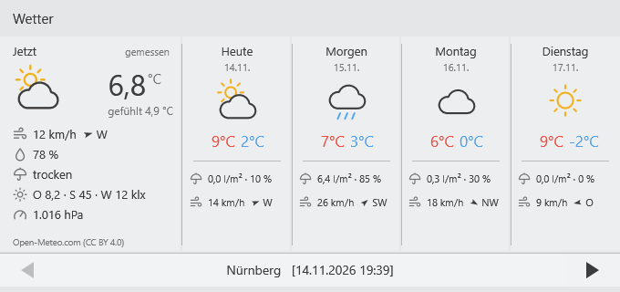

# QC-Plugin

Eigene Plugins für den **Gira QuadClient** am Gira HomeServer – in C#/.NET nach dem
QuadClient-Plugin-SDK, nutzbar im Windows-QuadClient und im [QC-Client](https://github.com/BadSmiley0815/QC-Client) (`qc.html`).

> **Plugin-IDs vorläufig:** Eine Plugin-ID besteht aus *Entwickler-ID + Nummer* (z. B. `1-3`).
> Die eigene Entwickler-ID ist bei Gira angefragt; bis zur Vergabe verwenden die Plugins hier
> die vorläufige Entwickler-ID **99**. Danach werden alle Plugins in allen Dateien umgestellt.

## Plugins

| ID (vorläufig) | Name | Stand |
|---|---|---|
| 99-1 | Wetter | läuft im Windows-QuadClient (HS+FS Experte 4.13, QuadClient 5.5) – Vorhersage (Open-Meteo) + aktuelle Werte der eigenen Wetterstation (KOs). Download: [`dist/99-1_Wetter.hsp`](dist/99-1_Wetter.hsp) |

## 99-1 Wetter




Ersatz für das Wetter-Plugin 1-3, ohne Gira-Dienst und ohne Geräteportal-Kennung.
(Die Bilder zeigen Beispieldaten aus dem Vorschauprogramm.)

### Installation in Kürze

1. [`dist/99-1_Wetter.hsp`](dist/99-1_Wetter.hsp) herunterladen.
2. Im HS+FS Experten das QuadClient-Projekt (QuadConfig) öffnen und die Datei als Plugin importieren.
3. Einen neuen Quadranten anlegen und als Plugin „Wetter (Open-Meteo + Wetterstation)“ wählen.
4. Unter „Wetter“ den Ort einstellen: bei „Ort suchen“ einen Ortsnamen eintragen (füllt Ort, Breite und Länge)
   oder die Koordinaten von Hand eintragen.
5. Wer eine Wetterstation am KNX hat: die passenden KOs aus dem Projekt auf die KO-Felder ziehen
   (alle optional, erwartete DPTs siehe unten).
6. Projekt auf den HomeServer übertragen, QuadClient neu starten.

Der QuadClient braucht Zugang zum Internet (`api.open-meteo.com`, HTTPS). Das Plugin läuft im
**Windows-QuadClient**. Giras Apps für iOS, Android und G1 laden keine fremden Plugins; im Experten sind die
Häkchen „Exportieren in …“ deshalb fest abgewählt.

- **Vorhersage:** [Open-Meteo](https://open-meteo.com) (kostenlos, ohne Schlüssel, Daten CC BY 4.0), 7 Tage,
  4 davon sichtbar, mit ◀ ▶ blättern.
- **„Jetzt“:** Werte der eigenen Wetterstation über KOs (Temperatur gemessen und gefühlt, Luftfeuchte, Windgeschwindigkeit,
  Windrichtung, Regen, Helligkeit, Luftdruck). Alle KOs sind optional; fehlt eines, gilt der Wert von Open-Meteo
  (Helligkeit und Luftdruck gibt es nur von der Station).
- **Offline:** Die letzte Vorhersage bleibt mit Zeitstempel stehen (Zwischenspeicher unter
  `%LOCALAPPDATA%\QC-Plugin\99-1\`), die Unterleiste zeigt dann „offline“.
- **Symbole:** im Code gezeichnet, helles und dunkles Design.

### Einstellungen im Experten

| Feld | Bedeutung |
|---|---|
| Ort suchen | Ortsname eingeben: der erste Treffer von Open-Meteo wird in Ort, Breite und Länge übernommen |
| Ort, Breite, Länge | Anzeigename und Koordinaten in Grad (Punkt oder Komma) – auch von Hand eintragbar |
| Aktualisierung | 15 min bis 6 h |
| Einheit Temperatur / Wind | °C oder °F, km/h oder m/s |
| KO Temperatur gemessen / gefühlt … Luftdruck | KO aus dem Projekt auf das Feld ziehen |
| Einheit des Wind-KO | m/s oder km/h – in welcher Einheit die Station sendet |

Erwartete Datenpunkttypen der KOs:

| KO | DPT | Wert |
|---|---|---|
| Temperatur gemessen | 9.001 | °C |
| Temperatur gefühlt | 9.001 | °C |
| Luftfeuchte | 9.007 | % |
| Windgeschwindigkeit | 9.005 oder 9.028 | m/s oder km/h (Einheit einstellen) |
| Windrichtung | 5.003 | Grad, 0 = Nord (jeder Zahlenwert in Grad geht) |
| Regen | 1.001 / 1.002 / 1.005 | 1 = Regen, 0 = trocken |
| Helligkeit gesamt | 9.004 | Lux – für Stationen mit einem Wert (z. B. mit GPS) |
| Helligkeit Nord / Ost / Süd / West | 9.004 | Lux – für Stationen mit einem Sensor je Himmelsrichtung; nur die vorhandenen zuweisen |
| Luftdruck | 9.006 | Pa (Werte über 2000 gelten als Pa) oder hPa; Anzeige in hPa |

Der Ort gilt für alle Geräte, die diese Plugin-Instanz anzeigen.

### Einstellungsformat (Projektdaten)

Die Einstellungen einer Instanz liegen auf dem HomeServer unter
`/quad/plugins/project/<Datei aus quad_plugin.xml>` als XML (UTF-8):

```xml
<project version="1" name="Nürnberg" lat="49.4542" lon="11.0775" interval="60" tu="celsius" wu="kmh" kowu="ms">
  <ko id="temp" tag="1234" />
  <ko id="hum" tag="1235" />
</project>
```

| Attribut | Werte | Bedeutung |
|---|---|---|
| `version` | `1` | Version dieses Formats |
| `name` | Text | Anzeigename des Orts |
| `lat`, `lon` | Dezimalgrad mit Punkt, leer = kein Ort | Breite (Nord positiv), Länge (Ost positiv) |
| `interval` | Minuten (15 … 1440) | Abruf der Vorhersage |
| `tu` | `celsius` \| `fahrenheit` | Einheit der Temperaturanzeige |
| `wu` | `kmh` \| `ms` | Einheit der Windanzeige |
| `kowu` | `ms` \| `kmh` | Einheit, in der das Wind-KO sendet |

`<ko>` steht nur für zugewiesene KOs. `id` ist eines von `temp` (gemessen, °C), `feel` (gefühlt, °C), `hum` (%), `wind`, `dir` (Grad, 0 = Nord),
`rain` (1 Bit, 1 = Regen), `lux` (Lux, ein Wert), `lux_n` / `lux_e` / `lux_s` / `lux_w` (Lux je Himmelsrichtung), `press` (hPa). `tag` ist die KO-ID des HomeServers als Zahl – dieselbe,
mit der sich der QuadClient für Wertänderungen anmeldet.

### Bauen

Braucht nur Windows mit .NET Framework 4 (kein Visual Studio, kein SDK) und die eigene Gira-Installation:

```powershell
.\build.ps1 -ExperteDir "C:\Program Files (x86)\Gira\HS+FS\HS+FS Experte 4.13" -QuadClientDir "<Ordner mit hs_client_net.exe>"
```

Die beiden Pfade sind nur beim ersten Mal nötig (die Bibliotheken werden nach `lib\gira` kopiert, das nicht
eingecheckt wird). Ergebnis: `dist\99-1_Wetter.hsp`. Jeder Bau erhöht die letzte Stelle der Version in
`version.xml` (`-NoBump` lässt sie stehen), prüft die Einstellungen mit `ConfigTest` und zeichnet die
Vorschaubilder mit `Vorschau` – beides ohne Experte und HomeServer. `-Live` fragt dabei wirklich bei Open-Meteo an.

### Entwickeln und Fehlersuche

1. Einbauen wie oben unter „Installation in Kürze“.
2. Zum Entwickeln ohne erneutes Übertragen kennt der Windows-QuadClient in seiner `config.xml` den Eintrag
   `<assembly path="..\quad_assembly\" />`. **Achtung:** Dann lädt er *alle* Plugin-DLLs aus diesem Ordner –
   dort müssen also auch die `<ID>_client.dll` der übrigen Plugins des Projekts liegen (aus den `.hsp` unter
   `Projekt\qc_hsp\`). `.\build.ps1 -DeployTo <Ordner>` kopiert die eigene Client-DLL dorthin.
3. Fehler des Plugins stehen im `error.log` des QuadClients (Zeilen mit „Wetter 99-1“).

## Aufbau eines Plugins (.hsp)

Eine `.hsp` ist ein ZIP mit:

| Datei | Zweck |
|---|---|
| `version.xml` | ID, Version, Name, Hersteller |
| `interface.xml` | Klassennamen der beiden Assemblies (`nsclient`, `nsconfig`) |
| `<ID>_client.dll` | Anzeige im QuadClient (WPF, implementiert `IQuadContent`) |
| `plugin_config.dll` | Einstellungen im Experten/QuadConfig (implementiert `IPlugin`) |
| `<ID>_lang.xml`, `config_lang.xml` | Texte für QuadClient bzw. Experte |
| `config_data.xml` | Daten für den Einstellungsdialog |
| `design_<n>/<ID>_design.xml`, Symbole | Darstellung |
| `thumbs/prev_<Sprache>.png` | Vorschaubild im Experten |
| `help/p<ID>_<Sprache>.pdf` | Hilfe im Experten |

Gebaut wird gegen `hs_client_framework.dll` (QuadClient) und `config_framework.dll`
(Experte, `quad_config\config`). **Diese Gira/DaCom-Bibliotheken sind nicht im Repository** –
sie werden beim Bauen aus der eigenen Installation referenziert.

## Lizenz

GNU General Public License v3.0 – siehe [`LICENSE`](LICENSE). Jeder darf die Plugins nutzen,
ändern und weitergeben; geänderte Fassungen müssen ebenfalls unter der GPL-3.0 offen bleiben.
Abwandlungen bitte mit eigener Entwickler-ID und angepasster Plugin-ID veröffentlichen.

## Hinweise

- Unabhängiges Projekt, **nicht von Gira** und nicht von Gira unterstützt. „Gira“,
  „HomeServer“ und „QuadClient“ sind Marken ihrer Inhaber.
- Enthält keinen Code, keine Bibliotheken und keine Grafiken von Gira/DaCom.
- Entwickelt mit Claude (Anthropic).
