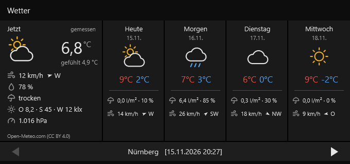
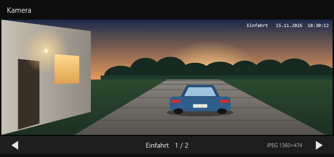
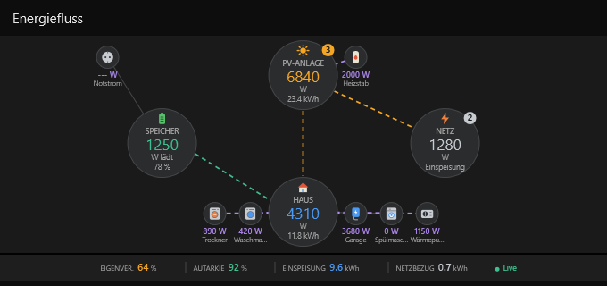
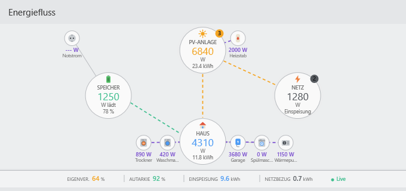
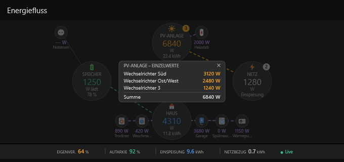

# QC-Plugin

Eigene Plugins für den **Gira QuadClient** am Gira HomeServer – in C#/.NET nach dem
QuadClient-Plugin-SDK, nutzbar im Windows-QuadClient und im [QC-Client](https://github.com/BadSmiley0815/QC-Client) (`qc.html`).

> **Plugin-IDs vorläufig:** Eine Plugin-ID besteht aus *Entwickler-ID + Nummer* (z. B. `1-3`).
> Die eigene Entwickler-ID ist bei Gira angefragt; bis zur Vergabe verwenden die Plugins hier
> die vorläufige Entwickler-ID **99**. Danach werden alle Plugins in allen Dateien umgestellt.

## Plugins

| ID (vorläufig) | Name | Stand |
|---|---|---|
| 99-1 | Wetter | läuft im Windows-QuadClient (HS+FS Experte 4.13, QuadClient 5.5) – Vorhersage (Open-Meteo) + aktuelle Werte der eigenen Wetterstation (KOs). Download: [`dist/99-1_Wetter.hsp`](dist/99-1_Wetter.hsp) |
| 99-2 | Kamera | läuft im Windows-QuadClient mit einer Axis-Kamera (weitere Hersteller noch nicht erprobt) – RTSP (H.264/H.265), ONVIF-Abfrage, MJPEG und Einzelbilder. Download: [`dist/99-2_Kamera.hsp`](dist/99-2_Kamera.hsp) |
| 99-3 | Energiefluss mit Verbrauchern | **im Experten und am HomeServer erprobt, Anzeige im Windows-QuadClient noch nicht** – PV, Speicher, Netz, Haus, bis zu 17 Verbraucher (Wallboxen, Waschmaschine, …) und Einzelwerte hinter jedem Kreis (z. B. mehrere Wechselrichter). Vorbild: „Energiefluss“ (180-1) von johannesbonn. Download: [`dist/99-3_Energiefluss.hsp`](dist/99-3_Energiefluss.hsp) |

## 99-1 Wetter




Ersatz für das Wetter-Plugin 1-3, ohne Gira-Dienst und ohne Geräteportal-Kennung.
(Die Bilder zeigen Beispieldaten aus dem Vorschauprogramm.)

### Installation in Kürze

1. [`dist/99-1_Wetter.hsp`](dist/99-1_Wetter.hsp) herunterladen.
2. Im HS+FS Experten das QuadClient-Projekt (QuadConfig) öffnen und die Datei als Plugin importieren.
3. Einen neuen Quadranten anlegen und als Plugin „Wetter (Open-Meteo + Wetterstation)“ wählen.
4. Unter „Wetter“ den Ort einstellen: bei „Ort suchen“ einen Ortsnamen eintragen (füllt Ort, Breite und Länge)
   oder die Koordinaten von Hand eintragen.
5. Wer eine Wetterstation am KNX hat: die passenden KOs aus dem Projekt auf die KO-Felder ziehen
   (alle optional, erwartete DPTs siehe unten).
6. Projekt auf den HomeServer übertragen, QuadClient neu starten.

Der QuadClient braucht Zugang zum Internet (`api.open-meteo.com`, HTTPS). Das Plugin läuft im
**Windows-QuadClient**. Giras Apps für iOS, Android und G1 laden keine fremden Plugins; im Experten sind die
Häkchen „Exportieren in …“ deshalb fest abgewählt.

- **Vorhersage:** [Open-Meteo](https://open-meteo.com) (kostenlos, ohne Schlüssel, Daten CC BY 4.0), 7 Tage,
  4 davon sichtbar, mit ◀ ▶ blättern.
- **„Jetzt“:** Werte der eigenen Wetterstation über KOs (Temperatur gemessen und gefühlt, Luftfeuchte, Windgeschwindigkeit,
  Windrichtung, Regen, Helligkeit, Luftdruck). Alle KOs sind optional; fehlt eines, gilt der Wert von Open-Meteo
  (Helligkeit und Luftdruck gibt es nur von der Station).
- **Offline:** Die letzte Vorhersage bleibt mit Zeitstempel stehen (Zwischenspeicher unter
  `%LOCALAPPDATA%\QC-Plugin\99-1\`), die Unterleiste zeigt dann „offline“.
- **Symbole:** im Code gezeichnet, helles und dunkles Design.

### Einstellungen im Experten

| Feld | Bedeutung |
|---|---|
| Ort suchen | Ortsname eingeben: der erste Treffer von Open-Meteo wird in Ort, Breite und Länge übernommen |
| Ort, Breite, Länge | Anzeigename und Koordinaten in Grad (Punkt oder Komma) – auch von Hand eintragbar |
| Aktualisierung | 15 min bis 6 h |
| Einheit Temperatur / Wind | °C oder °F, km/h oder m/s |
| KO Temperatur gemessen / gefühlt … Luftdruck | KO aus dem Projekt auf das Feld ziehen |
| Einheit des Wind-KO | m/s oder km/h – in welcher Einheit die Station sendet |

Erwartete Datenpunkttypen der KOs:

| KO | DPT | Wert |
|---|---|---|
| Temperatur gemessen | 9.001 | °C |
| Temperatur gefühlt | 9.001 | °C |
| Luftfeuchte | 9.007 | % |
| Windgeschwindigkeit | 9.005 oder 9.028 | m/s oder km/h (Einheit einstellen) |
| Windrichtung | 5.003 | Grad, 0 = Nord (jeder Zahlenwert in Grad geht) |
| Regen | 1.001 / 1.002 / 1.005 | 1 = Regen, 0 = trocken |
| Helligkeit gesamt | 9.004 | Lux – für Stationen mit einem Wert (z. B. mit GPS) |
| Helligkeit Nord / Ost / Süd / West | 9.004 | Lux – für Stationen mit einem Sensor je Himmelsrichtung; nur die vorhandenen zuweisen |
| Luftdruck | 9.006 | Pa (Werte über 2000 gelten als Pa) oder hPa; Anzeige in hPa |

Der Ort gilt für alle Geräte, die diese Plugin-Instanz anzeigen.

### Einstellungsformat (Projektdaten)

Die Einstellungen einer Instanz liegen auf dem HomeServer unter
`/quad/plugins/project/<Datei aus quad_plugin.xml>` als XML (UTF-8):

```xml
<project version="1" name="Nürnberg" lat="49.4542" lon="11.0775" interval="60" tu="celsius" wu="kmh" kowu="ms">
  <ko id="temp" tag="1234" />
  <ko id="hum" tag="1235" />
</project>
```

| Attribut | Werte | Bedeutung |
|---|---|---|
| `version` | `1` | Version dieses Formats |
| `name` | Text | Anzeigename des Orts |
| `lat`, `lon` | Dezimalgrad mit Punkt, leer = kein Ort | Breite (Nord positiv), Länge (Ost positiv) |
| `interval` | Minuten (15 … 1440) | Abruf der Vorhersage |
| `tu` | `celsius` \| `fahrenheit` | Einheit der Temperaturanzeige |
| `wu` | `kmh` \| `ms` | Einheit der Windanzeige |
| `kowu` | `ms` \| `kmh` | Einheit, in der das Wind-KO sendet |

`<ko>` steht nur für zugewiesene KOs. `id` ist eines von `temp` (gemessen, °C), `feel` (gefühlt, °C), `hum` (%), `wind`, `dir` (Grad, 0 = Nord),
`rain` (1 Bit, 1 = Regen), `lux` (Lux, ein Wert), `lux_n` / `lux_e` / `lux_s` / `lux_w` (Lux je Himmelsrichtung), `press` (hPa). `tag` ist die KO-ID des HomeServers als Zahl – dieselbe,
mit der sich der QuadClient für Wertänderungen anmeldet.

## 99-2 Kamera



Ergänzung zu Giras „Kameras 2.0“ (0-2), das nur JPEG und MJPEG per URL kennt. (Das Bild zeigt eine gezeichnete Beispielszene der
nachgebauten Kamera aus dem Vorschauprogramm.)

> **Stand:** Im Experten 4.13 und im Windows-QuadClient 5.5 mit einer Axis P1468-LE erprobt (ONVIF-Abfrage über
> HTTPS, RTSP H.264 mit 3840 × 2160). **Noch nicht** erprobt: Hikvision, Dahua, Vollbild, KO „Kamera anzeigen“,
> MJPEG und Einzelbilder an echten Kameras.

**Axis:** ONVIF hat eigene Konten (Weboberfläche der Kamera, System → ONVIF → „Konto hinzufügen“), und ab Werk gibt
es je Codec nur ein Profil in voller Auflösung. Dort am besten ein zweites ONVIF-Medienprofil mit H.264 und etwa
1280 × 720 anlegen und die Abfrage im Experten wiederholen – Einzelheiten in der Hilfe des Plugins.

- **RTSP** mit H.264, RTP über die RTSP-Verbindung (TCP), Anmeldung Digest oder Basic. Dekodiert wird mit dem
  H.264-Decoder von Windows (Media Foundation) – keine mitgelieferten Bibliotheken. H.265 ist vorbereitet, braucht
  auf dem Rechner die „HEVC-Videoerweiterung“ und ist ungeprüft.
- **ONVIF** im Experten: Adresse, Benutzer und Kennwort eintragen, „Kamera jetzt abfragen“ auf „Ja“ stellen –
  das Plugin trägt die RTSP-Adressen (kleiner Stream für den Quadranten, großer für das Vollbild) und die
  Einzelbild-Adresse ein.
- **MJPEG** (HTTP) und **Einzelbilder** (JPEG) wie bisher, mit Anmeldung Basic/Digest und HTTPS.
- **Mehrere Kameras** je Instanz (Liste im Experten), im QuadClient mit ◀ ▶ blättern; es läuft nur der Strom der
  sichtbaren Kamera. Ein Klick ins Bild schaltet das **Vollbild**.
- **KO „Kamera anzeigen“** je Kamera: ein Wert ungleich 0 (Klingel, Bewegungsmelder) schaltet auf diese Kamera um.
- Nach Verbindungsfehlern verbindet sich das Plugin von selbst neu; die Meldung steht über dem abgedunkelten letzten Bild.

Noch nicht enthalten: Schwenken/Neigen/Zoomen, Vierfachansicht, Ton, RTP über UDP, RTSP über TLS (`rtsps://`).

**Kennwort:** Benutzer und Kennwort der Kamera stehen lesbar in den Projektdaten und auf dem HomeServer (wie bei
Giras Plugin die URL mit `Benutzer:Kennwort@`). Deshalb in der Kamera einen eigenen Benutzer anlegen, der nur
ansehen darf. Zertifikate der Kameras werden bei HTTPS nicht geprüft (selbst ausgestellt).

### Einstellungsformat (Projektdaten)

```xml
<project version="1">
  <cam name="Einfahrt" host="192.168.1.20" port="80" user="viewer" pass="…" mode="auto"
       rtsp="rtsp://192.168.1.20:554/Streaming/Channels/102" rtsp_full="rtsp://192.168.1.20:554/Streaming/Channels/101"
       mjpeg="" jpeg="http://192.168.1.20/onvif/snapshot" refresh="1000">
    <ko id="show" tag="1234" />
  </cam>
</project>
```

| Attribut | Werte | Bedeutung |
|---|---|---|
| `version` | `1` | Version dieses Formats |
| `name` | Text | Anzeigename der Kamera |
| `host`, `port` | Adresse, 1 … 65535 | Kamera und Port ihres ONVIF-Dienstes (nur für die Abfrage im Experten) |
| `user`, `pass` | Text | Anmeldung für RTSP und HTTP |
| `mode` | `auto` \| `rtsp` \| `mjpeg` \| `jpeg` | Bildquelle; `auto` = RTSP, sonst MJPEG, sonst Einzelbilder – je nachdem, was eingetragen ist |
| `rtsp`, `rtsp_full` | `rtsp://…` | Stream für den Quadranten und für das Vollbild (leer = der jeweils andere) |
| `mjpeg`, `jpeg` | `http(s)://…` | MJPEG-Strom und Einzelbild |
| `refresh` | 100 … 60000 | Abstand der Einzelbilder in Millisekunden |

Die Reihenfolge der `<cam>` ist die Reihenfolge beim Blättern. `<ko id="show">` steht nur bei zugewiesenem KO;
`tag` ist die KO-ID des HomeServers. Für den QC-Client im Browser sind `jpeg` und `mjpeg` nutzbar, RTSP kann kein Browser.

## 99-3 Energiefluss mit Verbrauchern





Zeigt, wohin der Strom gerade fließt: PV-Anlage, Speicher, Netz und Haus als Kreise, dazu bis zu 17 einzelne
Verbraucher mit eigenem Symbol und Anschlusspunkt. Hinter jedem Kreis können Einzelwerte stehen, etwa drei Wechselrichter
hinter der PV-Anlage: Eine Scheibe am Kreis zeigt die Anzahl, ein Klick blendet sie ein. (Die Bilder zeigen Beispieldaten aus
dem Vorschauprogramm.)



**Vorbild und Dank:** Idee und Aufbau der Anzeige stammen vom Plugin „Energiefluss“ (180-1) von
[johannesbonn](https://knx-user-forum.de/member/39809-johannesbonn) aus dem KNX-User-Forum. 99-3 ist eine eigene,
unabhängige Entwicklung, weil sich 180-1 nicht um Verbraucher erweitern lässt. Aus dem Paket 180-1 ist nichts
übernommen – keine Dateien, keine Symbole, kein Code; Zeichnung und Symbole sind eigene. Die zwölf Grund-KOs haben
dieselbe Bedeutung wie dort, ein Umstieg ist also nur ein Umhängen der KOs.

> **Stand:** Einrichten im Experten 4.13, Speichern und Übertragen sind mit 0.1.3 erprobt; die Einstellungen kommen
> vollständig am HomeServer an (gelesen vom QC-Client). Die Anzeige ist bisher nur mit `Vorschau` gezeichnet –
> **noch nicht** erprobt: Anzeige und KO-Werte im Windows-QuadClient.
> Bei 0.1.2 kamen die Einstellungen einmal leer an; die Ursache ist nicht belegt und der Fehler mit 0.1.3 nicht
> wieder aufgetreten. Zur Fehlersuche schreibt das Plugin im Experten ein Protokoll nach
> `%LOCALAPPDATA%\QC-Plugin\99-3\experte.log` (enthält KO-IDs und Namen der Einträge).

- **Grund-KOs** (alle freiwillig): PV-, Speicher-, Haus- und Netz-Leistung in W (Netz positiv = Einspeisung,
  negativ = Bezug), Ladestand in %, Speicher-Zustand (1 = lädt, 2 = entlädt), PV-Ertrag und Verbrauch heute in kWh,
  Eigenverbrauch und Autarkie in %, Einspeisung und Netzbezug in kWh.
- **Verbraucher:** frei anlegbar in der Liste „Unterelemente“ des Experten, angezeigt werden höchstens 17. Je
  Verbraucher Name, Symbol (16 zur Wahl), Anschlusspunkt (Haus, PV, Speicher, Netz) und das KO der Leistung in W.
  Einträge ohne KO erscheinen nicht.
- **Einzelwerte:** in derselben Liste mit der Art „Einzelwert“, je Hauptkreis höchstens 8 – Name und KO der Leistung.
  Der Kreis zeigt weiter den Wert seines eigenen KOs; die Summe der Einzelwerte steht nur im eingeblendeten Feld.
- **Linien** laufen nur, wenn etwas fließt: PV → Haus, Netz → Haus bei Bezug, PV → Netz bei Einspeisung,
  Speicher ↔ Haus nach dem Speicher-Zustand. Bei Verbrauchern steht ohne Leistung ein dünner Strich; ein negativer
  Wert läuft zurück zum Anschlusspunkt.
- Das Plugin rechnet nichts um und bildet keine Summen.

### Einstellungsformat (Projektdaten)

```xml
<project version="1">
  <ko id="pv" tag="1234" />
  <ko id="netz" tag="1237" />
  <vb id="wb1" name="Garage" icon="wallbox" an="haus" tag="1250" />
  <vb id="wm" name="" icon="wasch" an="haus" tag="0" />
  <teil an="pv" name="Wechselrichter Süd" tag="1260" />
</project>
```

| Element / Attribut | Werte | Bedeutung |
|---|---|---|
| `ko id` | `pv` `bat` `haus` `netz` `soc` `batstate` `pvkwh` `evkwh` `evpct` `autpct` `einsp` `bezug` | Grund-KO; steht nur bei zugewiesenem KO |
| `vb id` | `wb1`…`wb4` `wm` `sm` `tr` `s1`… | Gibt nur Vorgabe-Name und -Symbol. Der Experte vergibt sie beim Speichern nach dem Symbol: Wallbox/Auto → `wb1`…`wb4`, die erste Waschmaschine → `wm`, Spülmaschine → `sm`, Trockner → `tr`, alles andere → `s1`, `s2`, … |
| `vb name` | Text | Anzeigename; leer = Vorgabe der Kennung (Wallbox n, Waschmaschine, Spülmaschine, Trockner, Verbraucher n) |
| `vb icon` | `wallbox` `auto` `wasch` `spuel` `trockner` `herd` `kuehl` `wp` `boiler` `klima` `licht` `steckdose` `pool` `tv` `pc` `sonst` | Symbol; unbekannt oder leer = Vorgabe des Platzes |
| `vb an` | `haus` \| `pv` \| `bat` \| `netz` | Anschlusspunkt; unbekannt oder leer = `haus` |
| `teil an` | `pv` \| `bat` \| `netz` \| `haus` | Hauptkreis, hinter dem der Einzelwert steht; anderes wird übergangen |
| `teil name` | Text | leer = „Wechselrichter n“ (pv), „Speicher n“ (bat), „Zähler n“ (netz), „Bereich n“ (haus) |
| `tag` | KO-ID des HomeServers | `0` oder leer = nicht belegt (der Eintrag wird dann nicht gezeigt) |

Gezeigt werden höchstens 17 `<vb>` und je Kreis 8 `<teil>` mit KO. Der Experte schreibt auch Einträge ohne KO (`tag="0"`),
erst alle `<vb>`, dann alle `<teil>`.
Die Reihenfolge der `<vb>` ist die der Liste im Experten und bestimmt die Plätze in der Anzeige. Der QC-Client
(`qc.html`) liest dieses Format unter der Klasse `99-3` und zeichnet dieselbe Anordnung.

## Bauen

Braucht nur Windows mit .NET Framework 4 (kein Visual Studio, kein SDK) und die eigene Gira-Installation:

```powershell
.\build.ps1 -ExperteDir "C:\Program Files (x86)\Gira\HS+FS\HS+FS Experte 4.13" -QuadClientDir "<Ordner mit hs_client_net.exe>"
```

Die beiden Pfade sind nur beim ersten Mal nötig (die Bibliotheken werden nach `lib\gira` kopiert, das nicht
eingecheckt wird). Ergebnis: `dist\99-1_Wetter.hsp`, `dist\99-2_Kamera.hsp` und `dist\99-3_Energiefluss.hsp`;
`-Plugin 99-2` baut nur eines.
Jeder Bau erhöht die letzte Stelle der Version in der `version.xml` der gebauten Plugins (`-NoBump` lässt sie
stehen), prüft die Einstellungen mit `ConfigTest` und zeichnet die Vorschaubilder mit `Vorschau` – ohne Experte
und HomeServer. `-Live` fragt bei 99-1 wirklich bei Open-Meteo an. Die Hilfe (`plugins\<Plugin>\help\*.html`)
druckt Microsoft Edge ohne Fenster als PDF ins Paket; ohne Edge entsteht das Paket ohne Hilfe.

Die Tests von 99-2 laufen gegen eine nachgebaute Kamera auf `127.0.0.1` (`tools\TestKamera.cs`: RTSP mit
Digest-Anmeldung, ONVIF, MJPEG, Einzelbild); den H.264-Strom dafür erzeugt der Encoder von Windows.

Eine echte Kamera prüft `bin\99-2\KameraTest.exe <Adresse> <Benutzer>` (ONVIF-Abfrage, RTSP, Decoder, Einzelbild).
Das Kennwort wird verdeckt abgefragt und nicht gespeichert; das dekodierte Bild landet als PNG in `bin\99-2\`.

## Entwickeln und Fehlersuche

1. Einbauen wie oben unter „Installation in Kürze“.
2. Zum Entwickeln ohne erneutes Übertragen kennt der Windows-QuadClient in seiner `config.xml` den Eintrag
   `<assembly path="..\quad_assembly\" />`. **Achtung:** Dann lädt er *alle* Plugin-DLLs aus diesem Ordner –
   dort müssen also auch die `<ID>_client.dll` der übrigen Plugins des Projekts liegen (aus den `.hsp` unter
   `Projekt\qc_hsp\`). `.\build.ps1 -DeployTo <Ordner>` kopiert die eigenen Client-DLLs dorthin.
3. Fehler der Plugins stehen im `error.log` des QuadClients (Zeilen mit „Wetter 99-1“, „Kamera 99-2“ bzw. „Energiefluss 99-3“).

## Aufbau eines Plugins (.hsp)

Eine `.hsp` ist ein ZIP mit:

| Datei | Zweck |
|---|---|
| `version.xml` | ID, Version, Name, Hersteller |
| `interface.xml` | Klassennamen der beiden Assemblies (`nsclient`, `nsconfig`) |
| `<ID>_client.dll` | Anzeige im QuadClient (WPF, implementiert `IQuadContent`) |
| `plugin_config.dll` | Einstellungen im Experten/QuadConfig (implementiert `IPlugin`). Der Assemblyname muss je Plugin verschieden sein (hier `<ID>_config`), sonst lädt der Experte nur die erste |
| `<ID>_lang.xml`, `config_lang.xml` | Texte für QuadClient bzw. Experte |
| `config_data.xml` | Daten für den Einstellungsdialog |
| `design_<n>/<ID>_design.xml`, Symbole | Darstellung |
| `thumbs/prev_<Sprache>.png` | Vorschaubild im Experten |
| `help/p<ID>_<Sprache>.pdf` | Hilfe im Experten |

Gebaut wird gegen `hs_client_framework.dll` (QuadClient) und `config_framework.dll`
(Experte, `quad_config\config`). **Diese Gira/DaCom-Bibliotheken sind nicht im Repository** –
sie werden beim Bauen aus der eigenen Installation referenziert.

## Lizenz

GNU General Public License v3.0 – siehe [`LICENSE`](LICENSE). Jeder darf die Plugins nutzen,
ändern und weitergeben; geänderte Fassungen müssen ebenfalls unter der GPL-3.0 offen bleiben.
Abwandlungen bitte mit eigener Entwickler-ID und angepasster Plugin-ID veröffentlichen.

## Hinweise

- Unabhängiges Projekt, **nicht von Gira** und nicht von Gira unterstützt. „Gira“,
  „HomeServer“ und „QuadClient“ sind Marken ihrer Inhaber.
- Enthält keinen Code, keine Bibliotheken und keine Grafiken von Gira/DaCom.
- 99-3 folgt in Idee und Aufbau dem Plugin „Energiefluss“ (180-1) von
  [johannesbonn](https://knx-user-forum.de/member/39809-johannesbonn) (KNX-User-Forum) und enthält nichts aus dessen Paket.
- Entwickelt mit Claude (Anthropic).
